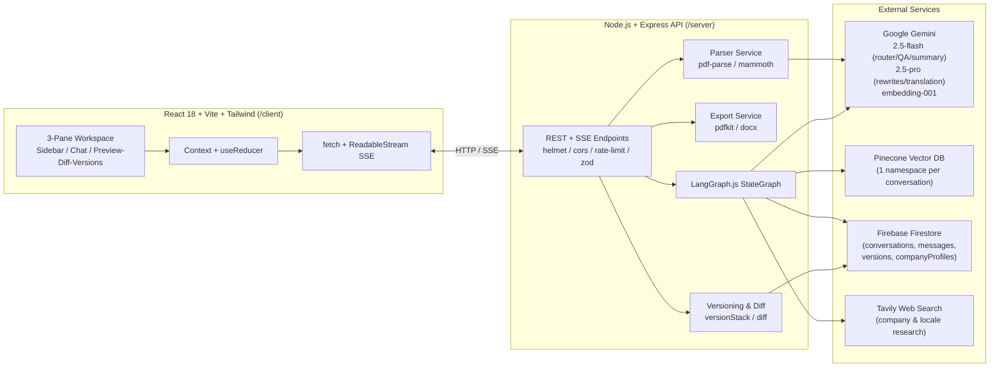
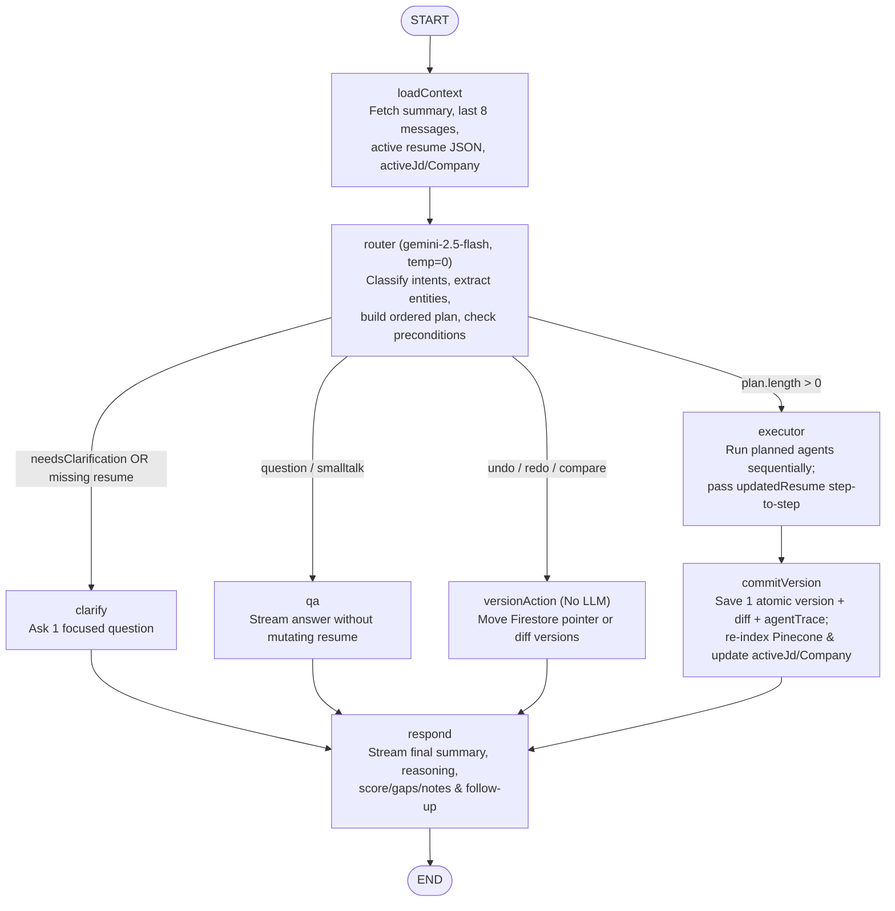

# Architecture — CareerFlow Resume AI

## 1. System Architecture

---

## 2. LangGraph.js `StateGraph` Flow

---

## 3. Agent Responsibilities

| Agent | File | Temperature | External Tools | Output & Side Effects |
|---|---|---|---|---|
| **Company Research & Optimization** | `server/src/agents/companyAgent.js` | `0` (profile), `0.4` (rewrite) | Tavily (4 queries) + Firestore `companyProfiles` (7-day TTL) | Builds company profile (values, keywords, tone, hiring signals); rewrites `summary` + bullets; updates `meta.targetCompany`. |
| **Job Description Matching** | `server/src/agents/jdMatchAgent.js` | `0` (extract/score), `0.4` (rewrite) | Pinecone (`namespace = conversationId`) | Indexes resume + JD chunks; maps requirements to top resume chunks; computes weighted score (`50%` required skills + `30%` responsibilities + `20%` seniority); returns `matchedSkills`, `missingSkills`, `suggestions`; rewrites target sections. |
| **Translation & Localization** | `server/src/agents/translationAgent.js` | `0.4` | Tavily (2 queries) | Researches regional CV norms (photo, length, date format, terminology); translates full canonical JSON; preserves proper nouns/tech terms; updates `meta.language` & `meta.locale`; returns `localizationNotes`. |
| **Section Enhancement** | `server/src/agents/sectionAgent.js` | `0.4` (enhance), `0.2` (consistency) | None (LLM-only 2-pass) | Pass 1 strengthens action verbs, XYZ impact framing, and adds `[X]`/`[X%]` placeholders for missing metrics; Pass 2 runs a whole-document consistency pass (tense, dates, punctuation, bullet length). |

---

## 4. Context Engineering Choices

1. **Canonical Structured Resume JSON (Never Raw Text)**:
   - Parsing converts PDF/DOCX into `resumeSchema` (`basics`, `experience`, `education`, `skills`, `projects`, `certifications`, `extraSections`, `meta`) once on upload.
   - All agents read and mutate typed JSON with preserved item `id`s, eliminating layout drift, enabling deterministic per-section diffing (`services/diff.js`), and ensuring clean ATS export (`services/export.js`).
2. **Windowed History + Rolling Summary**:
   - `loadContext` loads only the **last 8 messages** plus the persisted **`summary`** string—never the full conversation history.
   - After every **6 new messages** (`SUMMARY_INTERVAL = 6` in `services/conversation.js`), `gemini-2.5-flash` folds unsummarized messages into the rolling summary in the background of the turn completion.
3. **Selective Pinecone Retrieval**:
   - Resume chunks (summary, each experience item, each project, each skill group) are indexed in Pinecone under `namespace = conversationId`.
   - `jdMatchAgent` embeds JD requirements and retrieves only the top matching resume chunks (`topK = 3`) rather than bloating prompts with unstructured search dumps.
4. **Per-Agent Prompts, Temperatures & Schema Retries**:
   - Every agent has a dedicated system prompt in `server/src/prompts/*.js` specifying Role, Hard Rules (no fabrication, `[X]` placeholders), Input Format, and Output Zod Schema.
   - Temperature is `0` for routing/extraction/scoring and `0.4` for creative rewrites (`0.2` for consistency pass).
   - `invokeWithSchemaRetry` catches Zod validation errors and feeds the exact field-level issue messages back to Gemini for up to 2 retries.

---

## 5. Technology Rationale

- **Google Gemini (`2.5-flash` + `2.5-pro` + `gemini-embedding-001`)**: Splits latency/cost cleanly between fast deterministic routing/summaries (`flash`) and higher-quality prose rewriting/localization (`pro`), while supporting configurable `outputDimensionality` to match Pinecone.
- **LangGraph.js (`StateGraph`)**: Explicit state channels and conditional edges keep multi-intent planning, clarification guards, zero-LLM version actions, and sequential agent handoffs transparent, testable, and easy to stream via callbacks.
- **Pinecone**: Native per-conversation namespaces cleanly isolate each user session's resume and JD embeddings without cross-session leakage.
- **Firebase Firestore**: Document + subcollection hierarchy (`conversations/{id}/messages`, `conversations/{id}/versions`) fits chat threads, undo/redo pointer stacks, and 7-day `companyProfiles` TTL caching with transactional updates (`runTransaction`).
- **Tavily**: Purpose-built clean snippet search with source URLs keeps company research and local hiring conventions grounded in live web data, with graceful fallback if unavailable.
- **SSE over `fetch` + `ReadableStream`**: Unlike `EventSource` (GET-only), `fetch` POST lets the client send arbitrarily structured/large prompts (including pasted JDs) while still streaming fine-grained `agent_start`, `agent_step`, `agent_end`, `token`, and `version` events.

---

## 6. Tradeoffs & Future Improvements

- **Single Atomic Commit per Turn vs. Per-Step Commits**: Multi-step plans (`companyAgent -> translationAgent`) commit one combined version per turn so a single Undo reverts the whole request. With more time, exposing intermediate step snapshots inside an expandable version drawer would allow inspecting each intermediate step without cluttering the undo stack.
- **Anonymous `clientId` vs. Full Auth**: Storing `clientId` in `localStorage` satisfies zero-friction onboarding, but relies on unguessable Firestore document IDs rather than cryptographic user sessions. Adding Firebase Auth (optional sign-in) would enable cross-device sync and strict per-user authorization rules.
- **PDF Unicode Font Embedding**: `pdfkit` locates OS-installed Unicode TTF fonts (`Arial`, `DejaVuSans`, `LiberationSans`) when present and falls back to Helvetica. Bundling a permissive open-source font (e.g., Noto Sans) inside `/server/assets/fonts` would guarantee identical Unicode rendering across every container environment.
- **In-Process SSE vs. Distributed Job Queue**: Currently graph execution runs inside the HTTP request lifecycle with explicit timeouts (`45s` LLM, `12s` Tavily). Moving long multi-agent pipelines to a worker queue with Redis/PubSub pub-sub streaming would survive client disconnects and horizontal scaling.
